# Kiln

[](https://github.com/Proxeno/kiln/actions/workflows/ci.yml)
[](https://www.nuget.org/packages/Proxeno.Kiln)
[](https://www.nuget.org/packages/Proxeno.Kiln)
[](https://github.com/Proxeno/kiln/blob/main/LICENSE)
[](https://dotnet.microsoft.com)

**Kiln is an H.264 Baseline encoder written entirely in C#, for .NET applications that need
low-latency video without shipping a native codec.** You hand it raw I420 frames and it returns
Annex B access units. Motion search, transforms, CAVLC and deblocking are all implemented in this
repository against the ITU-T H.264 specification, with NEON, AVX2 and SSSE3 kernels and a scalar
fallback.

> **Status: pre-release (0.x).** The API can still change between minor versions.

## Contents

- [Quick start](#quick-start)
- [Platforms and SIMD](#platforms-and-simd)
- [What the encoder does and does not do](#what-the-encoder-does-and-does-not-do)
- [Options](#options)
- [Adaptive streaming](#adaptive-streaming)
- [Performance](#performance)
- [Kiln or a native encoder?](#kiln-or-a-native-encoder)
- [Sample, documentation and contributing](#sample-documentation-and-contributing)
- [License](#license)

## Quick start

```
dotnet add package Proxeno.Kiln
```

The package id is `Proxeno.Kiln`. The assembly and namespace are `Kiln`, and the package targets
.NET 10.

This is a complete console program. It encodes two seconds of a scrolling gradient at 720p and
writes a raw H.264 stream:

```csharp
using Kiln;

const int width = 1280, height = 720;

using var encoder = new H264BaselineEncoder(width, height, new H264BaselineEncoderOptions
{
    QuantizationParameter = 28,    // 0-51; lower is higher quality
    KeyframeIntervalFrames = 120,  // an IDR every 120 frames
    SliceCount = 4,                // four slices, encoded in parallel
});

// Planar I420: full-resolution luma, half-resolution chroma.
var y = new byte[width * height];
var u = new byte[width / 2 * (height / 2)];
var v = new byte[width / 2 * (height / 2)];
u.AsSpan().Fill(128);
v.AsSpan().Fill(128);

var annexB = new byte[encoder.RecommendedOutputBufferSize];
using var file = File.Create("out.h264");

for (var frame = 0; frame < 120; frame++)
{
    // Stand-in for your capture or render step: a scrolling gradient.
    for (var row = 0; row < height; row++)
    {
        for (var col = 0; col < width; col++)
        {
            y[row * width + col] = (byte)(col + row + frame * 4);
        }
    }

    var written = encoder.EncodeFrame(y, u, v, strideY: width, strideUv: width / 2, annexB);
    file.Write(annexB, 0, written);  // one complete Annex B access unit
}
```

Play the result with `ffplay out.h264`, or wrap it in a container with
`ffmpeg -framerate 60 -i out.h264 -c copy out.mp4`.

What to know about `EncodeFrame`:

- Each call returns one complete access unit. There is no lookahead and no frame delay.
- SPS and PPS are written ahead of every IDR, so a decoder can join at any keyframe.
- `encoder.LastFrameWasIdr` tells you whether the frame just written was a keyframe, and
  `EncodeFrame(..., forceKeyframe: true)` requests one.
- An encoder instance encodes one frame at a time. Calls on the same instance must not overlap.

## Platforms and SIMD

Kiln has no native code and no platform-specific code, so it runs wherever .NET 10 does. The
encoder picks one kernel set when it is constructed:

| CPU | Kernel set | Chosen when |
|---|---|---|
| x64 with AVX2 | `Avx2KernelSet` | `Avx2.IsSupported` |
| x64 without AVX2 | `Ssse3KernelSet` | `Ssse3.IsSupported` |
| arm64 | `Neon64KernelSet` | `AdvSimd.Arm64.IsSupported` |
| 32-bit Arm with NEON | `NeonKernelSet` | `AdvSimd.IsSupported` |
| anything else | `ScalarKernelSet` | always available |

Setting `PreferHardwareIntrinsics = false` forces the scalar set. SIMD kernels are tested for
bit-identical output against their scalar counterparts.

CI builds and runs the test suite on Linux and Windows (x64) and on macOS (arm64). The hosted x64
runners support AVX2, so the SSSE3-only and 32-bit Arm selections are not exercised as the active
kernel set in CI.

The library's only package dependency is `Microsoft.Extensions.Logging.Abstractions`, which the
rate-control layer uses for optional logging.

## What the encoder does and does not do

Kiln produces Constrained Baseline streams (`profile_idc` 66 with `constraint_set0_flag` and
`constraint_set1_flag` set).



| | Supported | Not supported |
|---|---|---|
| **Pictures** | IDR and P pictures, progressive frames | B-frames, interlaced or field coding |
| **Entropy coding** | CAVLC | CABAC |
| **Transform** | 4×4 integer transform | 8×8 transform |
| **Intra prediction** | Intra 4×4 (9 modes), Intra 16×16 (4 modes), intra macroblocks inside P pictures | |
| **Inter prediction** | 16×16, 16×8, 8×16 and 8×8 partitions, quarter-pel motion vectors, `P_Skip`, up to 2 reference frames | Partitions below 8×8, weighted prediction, long-term references |
| **Loop filter** | In-loop deblocking (can be switched off) | |
| **Slices** | 1 to 8 slices per frame, encoded in parallel | FMO, ASO, redundant slices |
| **Input** | Planar I420, 8-bit 4:2:0 | Other chroma formats or bit depths, colour conversion, scaling |
| **Output** | Annex B byte stream | MP4 or any other container, RTP packetization |
| **Rate control** | Constant QP, a per-frame bit budget, variance-based adaptive QP | HRD or VBV conformance |
| **Error recovery** | Forced IDR, gradual intra refresh with a recovery-point SEI | |

Other limits and behaviours worth knowing:

- **Frame size.** Width and height must be even. They need not be multiples of 16: Kiln pads to the
  macroblock grid internally and signals the true size through SPS cropping, so 1920×1080 or
  1366×768 decode at exactly that size. The largest coded picture is 36,864 macroblocks (the
  Level 5.2 limit).
- **Level.** With `LevelIdc = 0` (the default) Kiln signals the lowest level whose frame-size limit
  (MaxFS) fits the padded picture, and never less than Level 3.1. 1920×1080 signals Level 4.0. Only
  the frame-size limit is checked. Bitrate and macroblock-rate limits are not enforced.
- **Colour and timing.** The SPS describes the video as BT.601, limited range. It carries no timing
  information, so frame rate lives in your container or transport.
- **Decoder.** Kiln is an encoder only.

## Options

`H264BaselineEncoderOptions` is read once, when the encoder is constructed.

| Option | Default | What it does |
|---|---|---|
| `QuantizationParameter` | 28 | Base QP, 0–51. Lower is higher quality and more bits. |
| `KeyframeIntervalFrames` | 60 | An IDR every N frames. The first frame is always an IDR. |
| `SliceCount` | 1 | Slices per frame, 1–8. More than one encodes slices in parallel and limits how much of a frame a lost packet can damage. `null` picks `min(macroblock rows, max(1, ProcessorCount − 1), 8)`. |
| `SpeedMode` | `HighQuality` | Preset over the four motion-search options marked † below: `HighQuality`, `Balanced`, `Fast` or `VeryFast`. See [Speed modes](#speed-modes). |
| `MaxReferenceFrames` † | 2 | Reference frames, 1 or 2. Use 1 for decoders that expect single-reference streams. |
| `UseMotionSatd` † | true | Score integer-pel motion candidates with SATD instead of SAD. |
| `SubPartitionRangeCap` † | 16 | Search radius, in pixels, for partitions smaller than 16×16. |
| `MotionSearchEffortCapPerMb` † | 0 (off) | Caps motion-search work per frame. See [Worst case](#worst-case). |
| `FastSearch` | true | Hexagon and diamond integer search with quarter-pel refinement. `false` searches exhaustively. |
| `EnableIntraInPFallback` | true | Lets a P picture code a macroblock as intra when inter prediction is poor. |
| `TargetBitsPerFrame` | 0 (off) | Per-frame bit budget. The encoder adjusts QP per macroblock to approach it. Can be overridden per call with `EncodeFrame(targetBitsPerFrame:)`. |
| `AdaptiveQuantStrength` | 0.0 (off) | Variance-based adaptive QP. 1.0 is standard strength. Typical values are 0.5–1.5. |
| `TrellisLevel` | 0 (off) | 1 enables greedy per-coefficient trellis quantization. |
| `IntraRefreshPeriodFrames` | 0 (off) | N > 0 enables gradual intra refresh and spreads each refresh wave over up to N frames. See [Loss recovery](#loss-recovery). |
| `LightweightDeblocking` | false | Turns the deblocking filter off, in the encoder and (through the slice header) in the decoder. |
| `PreferRealtimeLatencyTuning` | false | Skips chroma-DC rate-distortion refinement on inter-coded chroma. |
| `PreferHardwareIntrinsics` | true | `false` forces the scalar kernels. |
| `LevelIdc` | 0 (auto) | `level_idc` to signal. A level too small for the frame makes the constructor throw. |
| `ProfileIdc` | 66 | Baseline. No other value is accepted. |
| `ChromaDcRdLambda`, `Intra4x4SadLambda` | null | Rate-distortion weight overrides. Leave them unset. |
| `ExperimentalZeroMvSkipSadThreshold` | null | Experimental. Leave it unset. |

† An option you assign explicitly always wins over `SpeedMode`. The mode only fills in the ones
you leave alone.

Three things can also be changed on a live encoder, between frames and without an IDR: the slice
QP (`EncodeFrame(sliceLumaQp:)`), the bit budget (`EncodeFrame(targetBitsPerFrame:)`), and the
four † options (`ApplySpeedMode` and `ApplySpeedKnobs`). The reference count can never exceed
the value the encoder was constructed with.

### Loss recovery

A forced IDR is the simple way to recover a decoder after packet loss, but an IDR is many times
larger than a P picture. Gradual intra refresh spreads the cost: construct the encoder with
`IntraRefreshPeriodFrames = N`, call `RequestIntraRefresh()`, and a band of intra-coded macroblock
columns sweeps across the picture over up to N frames. A decoder that joins at the first frame of
the wave, where Kiln repeats SPS and PPS and adds a recovery-point SEI, has a bit-exact picture
once the wave completes.

Enabling the option sets `constrained_intra_pred_flag` for the whole stream, which costs a little
quality even when no wave is running. Measured at 640×480, QP 30, on motion content: a wave peaks
at about 2.7× a typical P picture per frame where an IDR costs about 14×, and the standing cost of
the flag is +0.3% to +1.1% bits.

## Adaptive streaming

`H264StreamingSession` wraps an encoder and a rate controller. Each frame you give it the latest
network feedback, and it chooses the QP, the bit budget, the speed mode and when to send an IDR:

```csharp
using Kiln;
using Kiln.RateControl;

const int width = 1280, height = 720;
var y = new byte[width * height];
var u = new byte[width / 2 * (height / 2)];
var v = new byte[width / 2 * (height / 2)];

using var session = new H264StreamingSession(width, height);
var annexB = new byte[session.RecommendedOutputBufferSize];

// Each frame: pass the latest transport snapshot, get an adapted access unit back.
var feedback = new EncoderNetworkFeedback(
    EstimatedAvailableBitrateBps: 6_000_000,   // 0 = no estimate
    PacketLossRatio: 0.0,
    RoundTripTime: TimeSpan.FromMilliseconds(30),
    Jitter: TimeSpan.Zero,                     // zero = not measured
    PendingRtpBytes: 0,
    NackCount: 0,
    PictureLossIndication: false,              // set for exactly one frame per PLI
    FullIntraRequest: false,
    ClientDecodeDelay: null);

var result = session.EncodeFrame(y, u, v, strideY: width, strideUv: width / 2, annexB, feedback);

Console.WriteLine($"{result.BytesWritten} bytes, IDR={result.WasIdr}, QP={result.AppliedSliceQp}, " +
                  $"target={result.Decision.TargetBitrateBps} bps, mode={result.AppliedSpeedMode}");
```

How the session uses each input:

| Feedback | Effect |
|---|---|
| Packet loss, NACKs, send-queue backlog, an RTT spike | Congestion: the target bitrate steps down, then climbs back after a stable period. |
| `EstimatedAvailableBitrateBps` | A hard ceiling on the target bitrate. |
| `Jitter` | A spike holds bitrate increases. It never causes a cut. |
| `ClientDecodeDelay` | A client that cannot keep up gets a cheaper stream to decode (speed mode, then frame rate, then resolution). Bitrate is not cut. |
| `PictureLossIndication`, `FullIntraRequest` | An IDR, or a refresh wave if an IDR was sent too recently and intra refresh is enabled. |

Things the session leaves to you:

- **Resolution.** Kiln has no scaler. When the controller wants a different size, the result sets
  `ResolutionChangeRecommended`. If you can supply frames at that size, call `ChangeResolution`.
  The next frame is then an IDR with a new SPS.
- **Frame rate.** `TargetFps` is a pacing request for your capture loop. It changes the per-frame
  bit budget but nothing in the bitstream.
- **Frame dropping.** Pacing and dropping late frames belong to your capture loop. Report drops
  through `EncoderPipelineTimings` and the controller takes them into account.

`RateControlConfig` defaults suit 1080p60 game streaming (8 Mbps initial target, 0.5–50 Mbps
range, a 60/30/15 fps ladder). Set it for your own link and content.

The session is deterministic: the same frames and the same feedback produce the same bytes.
[docs/architecture.md](https://github.com/Proxeno/kiln/blob/main/docs/architecture.md#rate-control-and-recovery)
describes the controller and exactly what may change mid-stream.

## Performance

Every figure in this section was measured on one machine: an Apple M5 Max (arm64, NEON), .NET 10,
with the machine otherwise idle. They are steady-state P-picture times at QP 28 on synthetic
content, taken with the harnesses in
[`bench/Kiln.Benchmarks`](https://github.com/Proxeno/kiln/tree/main/bench/Kiln.Benchmarks). No
x64 figures are published yet. Measure on your own hardware and content before sizing a
deployment.

### Slices

Median P-picture time with default options on a textured scroll with noise, which stands in for a
camera pan or a scrolling game (`--slice-quick`):

| Resolution | 1 slice | 2 slices | 4 slices | 8 slices |
|---|---:|---:|---:|---:|
| 640×480 | 17.3 ms | 8.6 ms | 5.6 ms | 4.0 ms |
| 1280×720 | 19.9 ms | 16.0 ms | 9.4 ms | 7.5 ms |
| 1920×1080 | 24.4 ms | 16.9 ms | 10.9 ms | 10.8 ms |

Slices do not scale linearly. At 1080p, four slices are about 2.2× faster than one, and eight add
almost nothing over four. Slices also cost bits, because prediction does not cross a slice
boundary: going from 1 to 4 slices measured +5% to +26% bitrate at QP 28, depending on content.
Choose `SliceCount` for latency and loss confinement, and budget for both costs.

### Speed modes

`SpeedMode` trades compression for speed. Median 1080p P-picture times (`--speed-modes-timing`),
on the same scroll content ("coherent") and on a stress pattern of opposing scrolls with
counter-moving blocks ("divergent"):

| Mode | What it sets | Coherent, 1 / 4 slices | Divergent, 1 / 4 slices |
|---|---|---:|---:|
| `HighQuality` (default) | 2 references, SATD search, radius 16, no effort cap | 26.6 / 10.0 ms | 205 / 70 ms |
| `Balanced` | 1 reference, effort cap 512 | 18.8 / 8.2 ms | 80 / 30 ms |
| `Fast` | 1 reference, radius 8, effort cap 256 | 15.6 / 7.7 ms | 64 / 24 ms |
| `VeryFast` | 1 reference, SAD search, radius 8, effort cap 128 | 8.9 / 4.0 ms | 20 / 7.8 ms |

The quality cost against `HighQuality`, as PSNR and bitrate at 1080p, QP 28 (`--speed-modes`):

| Mode | Static | Coherent motion | High motion | Scene cut | Divergent motion |
|---|---|---|---|---|---|
| `Balanced` | none | −0.1 dB, +1% | −1.6 dB, +12% | +0.3 dB, −3% | −0.4 dB, +40% |
| `Fast` | none | −0.1 dB, +1% | −1.7 dB, +11% | +0.4 dB, −4% | −0.5 dB, +55% |
| `VeryFast` | none | −1.2 dB, +7% | −3.5 dB, +21% | −0.9 dB, +2% | −1.5 dB, +64% |

On static and gently moving content `Balanced` and `Fast` cost almost nothing. On violent content
the capped modes hold their frame time and pay for it in quality and bits. The cost is larger at
low QP: at QP 23, `Balanced` measured −6.8 dB on the high-motion content and −3.7 dB on scene
cuts.

### Worst case

With default options, frame time depends heavily on content: 205 ms on the divergent pattern
against 27 ms on coherent motion, at 1080p with one slice. `HighQuality` is the only mode with no
bound on that.

`MotionSearchEffortCapPerMb` is the bound. It is a budget of motion-search work per frame, and as
a frame uses it up the search narrows in steps. It counts work rather than time, so output stays
deterministic, and it costs quality only on frames that reach it.

To keep the `HighQuality` settings and still bound the worst case, set the cap yourself:

```csharp
using Kiln;
using Kiln.RateControl;

var encoder = new H264BaselineEncoder(1920, 1080, new H264BaselineEncoderOptions
{
    SpeedMode = EncoderSpeedMode.HighQuality,
    MotionSearchEffortCapPerMb = 512,  // an explicit value wins over the mode
    SliceCount = 4,
});
```

In the same measurements that costs about 0.01 dB on coherent content and brings the divergent
case down from 70 ms to roughly 35–40 ms at 4 slices.

### Kernel benchmarks

The repository gates changes against a committed BenchmarkDotNet baseline,
[`perf/h264-simd-perf-baseline-latest.json`](https://github.com/Proxeno/kiln/blob/main/perf/h264-simd-perf-baseline-latest.json),
captured on an arm64 Mac:

| Benchmark | Mean |
|---|---:|
| SATD 4×4 | 11.2 ns |
| SATD 4×4 over 9 intra modes | 99.3 ns |
| SAD 8×8 | 3.5 ns |
| SAD 16×16 | 6.4 ns |
| 16×16 motion search, range 8 | 76.4 µs |
| P picture, 1280×720, 1 slice, near-static content | 2.24 ms |

The last row uses near-static content, so it is a regression guard and not a number to size a
deployment from.
[docs/perf-gate.md](https://github.com/Proxeno/kiln/blob/main/docs/perf-gate.md) explains the gate.

## Kiln or a native encoder?

Native encoders such as x264 and OpenH264, and hardware encoders such as NVENC, Quick Sync and
VideoToolbox, are faster and compress better. They implement Main and High profile tools that Kiln
lacks (B-frames, CABAC, the 8×8 transform), and the software ones have had many years of tuning.
This repository publishes no head-to-head measurements against them.

Choose Kiln when what you need is:

- **One managed dependency.** No native binary to build, sign or ship per platform, and no
  P/Invoke. A NuGet reference is the whole deployment.
- **Apache-2.0 source.** Kiln links no GPL or LGPL code.
- **Low, predictable latency.** One frame in, one access unit out, no lookahead, a deterministic
  bound on worst-case work, and a rate controller built for interactive streams.
- **Baseline output.** Constrained Baseline is the H.264 profile every WebRTC endpoint that
  offers H.264 must support.

Choose a native or hardware encoder when you need the smallest stream for a given quality, High
profile, the highest resolutions and frame rates on modest CPUs, or offline transcoding.

One caution: Apache-2.0 covers Kiln's source code. It does not grant rights to patents on the
H.264 standard that are held by third parties. Check whether your use needs a licence for those.

## Sample, documentation and contributing

- [`samples/Kiln.Capture`](https://github.com/Proxeno/kiln/tree/main/samples/Kiln.Capture) records
  a camera to a playable `.m4v`, with capture, colour conversion, encoding and MP4 muxing all in
  managed code:

  ```
  dotnet run --project samples/Kiln.Capture -- list
  dotnet run --project samples/Kiln.Capture -- record --seconds 10 --output capture.m4v
  ```

- [docs/architecture.md](https://github.com/Proxeno/kiln/blob/main/docs/architecture.md) covers the
  encode pipeline, slice threading, the SIMD kernel sets and the rate controller.
- [docs/perf-gate.md](https://github.com/Proxeno/kiln/blob/main/docs/perf-gate.md) covers the
  benchmark baseline and the regression gate.
- [CONTRIBUTING.md](https://github.com/Proxeno/kiln/blob/main/CONTRIBUTING.md) covers building,
  testing and the rules for contributions.
- [SECURITY.md](https://github.com/Proxeno/kiln/blob/main/SECURITY.md) covers reporting a
  vulnerability.

## License

Apache-2.0. See [LICENSE](https://github.com/Proxeno/kiln/blob/main/LICENSE). © Kiln contributors.
