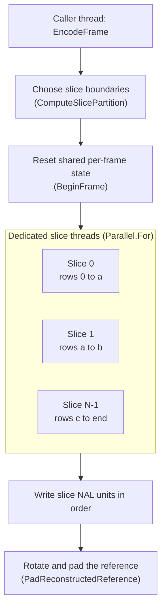
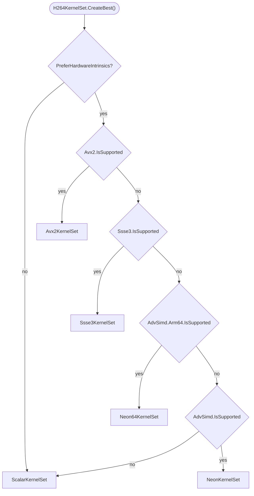
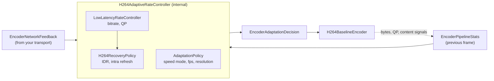

# Architecture

This document explains how Kiln turns raw I420 frames into an Annex B H.264 stream, how its SIMD
kernels are organised and selected, and how the rate-control layer sits on top of the encoder. It
is written for contributors. For the public API, start with the [README](../README.md).

Spec references (`§8.7`, `Table 8-17`) are to ITU-T H.264.

- [Encode pipeline](#encode-pipeline)
- [Slice threading](#slice-threading)
- [SIMD kernel sets](#simd-kernel-sets)
- [Rate control and recovery](#rate-control-and-recovery)
- [What can change mid-stream](#what-can-change-mid-stream)
- [Diagnostics](#diagnostics)

## Encode pipeline

### Frame setup: `H264BaselineEncoder`

[`src/Kiln/H264BaselineEncoder.cs`](../src/Kiln/H264BaselineEncoder.cs) is the public entry point.
An encoder instance owns:

- One `H264FrameSharedState`: the picture-sized reconstruction, the reference pictures, and the
  per-macroblock neighbour caches that every slice shares.
- Up to 8 `H264BaselineSliceEncoder` instances, one per slice. Each has its own RBSP buffer,
  rate-control state and slice-header state.
- The SPS and PPS, built once at construction by `H264ParameterSets`.

Each `EncodeFrame` call does the following:

1. **Extends the source if needed.** See [Coded and display size](#coded-and-display-size).
2. **Decides the picture type.** The picture is an IDR when it is the first frame, when
   `forceKeyframe` is set, or when the frame index is a multiple of `KeyframeIntervalFrames`.
   Otherwise it is a P picture.
3. **Writes parameter sets.** SPS and PPS go ahead of IDR pictures only. Repeating them before
   every P picture is unusual, and some hardware decoders handle it badly. The one exception is the
   first frame of a gradual-intra-refresh wave, which repeats SPS and PPS and adds a
   recovery-point SEI so that a decoder can join there.
4. **Encodes the slices.** With one slice, `_sliceEncoders[0].EncodeSliceRbsp` runs on the calling
   thread. With more, `EncodeFrameMultiSlice` runs them in parallel. See
   [Slice threading](#slice-threading).
5. **Wraps each slice in a NAL unit** and appends it to the caller's buffer.
6. **Measures the content.** `UpdateContentActivity` derives the motion, texture and scene-change
   signals that the rate controller reads (`LastFrameMotionComplexity` and its siblings).

### Coded and display size

The public API speaks *display* size: `Width` and `Height` are what the caller passed and what a
decoder outputs. Everything below `H264BaselineEncoder` works in *coded* size, `CodedWidth` and
`CodedHeight`, which is the display size rounded up to the 16×16 macroblock grid.

When the two differ:

- The SPS carries a frame-cropping block (§7.3.2.1.1) that signals the display size. Only the
  right and bottom offsets are used, in units of 2 luma samples (§7.4.2.1.1, Table 6-1). That is
  why dimensions must be even.
- `H264SourcePlaneExtender` extends the caller's planes to coded size by replicating the last real
  column and row. Replication matters: the padding is coded, deblocked and stored as reference,
  and the loop filter (§8.7) reads it when it filters visible samples next to the crop edge.
  Replicated padding also tends to code as `P_Skip`.
- `LastReconstructedY`, `LastReconstructedU` and `LastReconstructedV` return the coded planes,
  because that is what must match a decoder's reference pictures. `CopyLastReconstructedTo` gives
  a display-sized copy.

For dimensions that are already multiples of 16 the extension step is skipped.

### The macroblock loop: `H264BaselineSliceEncoder`

[`src/Kiln/Internal/H264/H264BaselineSliceEncoder.cs`](../src/Kiln/Internal/H264/H264BaselineSliceEncoder.cs)
does the coding work, in `EncodeSliceRbsp`. For each macroblock in the slice, in raster order:

1. **Inter prediction** (P pictures with a valid reference). `TryEncodePInterMacroblock` asks
   `H264MotionEstimator` for an integer-pel search (hexagon and diamond by default, exhaustive
   when `FastSearch` is false) and then a quarter-pel refinement. Candidates are scored with SATD
   or SAD (`UseMotionSatd`), with motion vectors predicted per §8.4.1.3. `SearchMbSubPartitions`
   chooses among 16×16, 16×8, 8×16 and 8×8 partitions. `P_Skip` is decided here too.
2. **Intra inside P pictures.** When `EnableIntraInPFallback` is set (the default), the inter
   winner is scored against the best Intra 16×16 candidate and the cheaper one wins. Where inter
   prediction did badly, Intra 4×4 is tried as well. This rescues content that no reference
   contains, such as the leading edge of a scroll, an uncovered background or a scene change. The
   code and the diagnostics call this step *Phase 2b*.
3. **Intra coding.** `WriteMacroblock` handles every macroblock of an IDR picture and any
   macroblock in a P picture that did not take the inter path. It chooses between Intra 4×4 (9
   modes) and Intra 16×16 (4 modes) by cost. Which modes are available follows the neighbour rules
   of §8.3.1.1 and §8.3.1.2.
4. **Transform and quantization.** `H264BlockTransform` is the scalar 4×4 forward transform and
   quantizer. `H264BlockTransformSimd`, `H264Dct4x4Simd` and `H264BlockTransformDequantSimd` are
   the SIMD versions. `H264LumaDcHadamard` and `H264ChromaDcScale` handle the DC transforms.
   `TrellisLevel = 1` adds `H264TrellisQuant4x4`, a greedy per-coefficient pass.
5. **Entropy coding.** `H264CavlcResidual` writes each 4×4 block with the tables in
   `H264CavlcTables`, directly into the slice's bit buffer (`H264RbspBitBuffer`).
6. **Reconstruction.** The decoded residual is added back into the shared reconstruction planes as
   each macroblock is coded, because later macroblocks predict from it.

After the loop:

7. **Deblocking.** `H264DeblockingFilter` or `H264DeblockingFilterSimd` filters the slice's rows.
   `LightweightDeblocking` skips this step and signals that in the slice header.
8. **Reference update.** The reconstruction becomes a reference picture.
   `H264ReferencePicturePadder` rebuilds the border around it (§8.4.2.1): 16 samples for luma and
   8 for chroma, enough for the 6-tap luma and bilinear chroma interpolation filters. The encoder
   keeps at most 2 reference pictures (`H264FrameSharedState.MaxDpbSize`).

Back in `H264BaselineEncoder`, `H264AnnexB.AppendNal` turns each slice's RBSP into a NAL unit:
`H264RbspEmulation` inserts emulation-prevention bytes, and a start code and NAL header go in
front.

### Per-macroblock QP

Inside the encoder, `H264RateControl`
([`Internal/H264/H264RateControl.cs`](../src/Kiln/Internal/H264/H264RateControl.cs)) adjusts QP
per macroblock. It is active only when a per-frame bit budget is set, either through
`TargetBitsPerFrame` at construction or through `EncodeFrame(targetBitsPerFrame:)`. Without a
budget the encoder runs at constant QP. Multi-slice frames give each slice a share of the budget.

This is separate from the public `Kiln.RateControl` namespace, which decides *what the budget
should be*. See [Rate control and recovery](#rate-control-and-recovery).

## Slice threading

A frame is cut into horizontal bands of macroblock rows, one slice each. `SliceCount` sets how
many. `null` means `min(macroblock rows, max(1, ProcessorCount − 1), 8)`.

**Threads.** Slices run under `Parallel.For` on a `LimitedConcurrencyLevelTaskScheduler`. This is
a small pool of background threads that all encoders in the process share and that is separate
from the .NET thread pool, which avoids the thread-pool's injection delays. It holds
`min(8, max(1, ProcessorCount − 1))` threads.

**Why it is race-free.** Each slice writes only its own rows of the shared reconstruction and
per-macroblock arrays, so writes never overlap. The two steps that touch the whole frame,
`BeginFrame` before and `PadReconstructedReference` after, run on the calling thread outside the
parallel region. The caller's input planes are pinned for the duration so that worker threads can
read them without a copy.

**Deblocking.** Multi-slice pictures set `disable_deblocking_filter_idc = 2`, which filters inside
each slice but not across slice boundaries. That is what lets each slice deblock its own rows
independently.

**Where the boundaries go.** The frame takes as long as its slowest slice, and equal-height slices
are rarely equal work, because motion tends to concentrate in part of the picture.
`ComputeSlicePartition` therefore moves the boundaries so that slices carry similar predicted
work. Its signal is the motion-search effort each macroblock row consumed over the previous 8
frames. That is a count of candidate evaluations and not a time measurement, so the partition is
the same on every run and the output stays deterministic. The spec leaves boundary placement to
the encoder (§7.4.3). With SAD-scored search (`UseMotionSatd = false`) the slices stay equal in
height.

**The single-slice path** does not use the pool at all. One slice encoder does the reset, the
macroblock loop, deblocking and the reference update on the calling thread.

## SIMD kernel sets

Every hot per-block operation sits behind one internal interface,
[`IH264KernelSet`](../src/Kiln/Internal/H264/IH264KernelSet.cs): SAD, SATD, SSD, variance, intra
prediction, transform and quantization, deblocking, and luma and chroma interpolation. An encoder
resolves one kernel set at construction and uses it for its whole life. Nothing is dispatched per
call.

| Kernel set | Target | Derives from | File |
|---|---|---|---|
| `Avx2KernelSet` | x64 with AVX2 | `Ssse3KernelSet` | [`Avx2KernelSet.cs`](../src/Kiln/Internal/H264/Avx2KernelSet.cs) |
| `Ssse3KernelSet` | x64 with SSSE3 | `SimdKernelSetBase` | [`Ssse3KernelSet.cs`](../src/Kiln/Internal/H264/Ssse3KernelSet.cs) |
| `Neon64KernelSet` | arm64 (`AdvSimd.Arm64`) | `NeonKernelSet` | [`Neon64KernelSet.cs`](../src/Kiln/Internal/H264/Neon64KernelSet.cs) |
| `NeonKernelSet` | Arm (`AdvSimd`) | `SimdKernelSetBase` | [`NeonKernelSet.cs`](../src/Kiln/Internal/H264/NeonKernelSet.cs) |
| `ScalarKernelSet` | any CPU | none | [`ScalarKernelSet.cs`](../src/Kiln/Internal/H264/ScalarKernelSet.cs) |

[`SimdKernelSetBase`](../src/Kiln/Internal/H264/SimdKernelSetBase.cs) implements the kernels whose
SIMD code is shared across architectures, by delegating to helper types such as `H264MotionSatd`,
`H264Intra4X4Prediction` and `H264QpelLumaInterp`. It leaves the SAD family, the SSD kernels and
`VarianceMb16x16` abstract for each architecture to supply. The wider set in each family
(`Avx2KernelSet`, `Neon64KernelSet`) overrides only the kernels where the wider instructions help
and inherits the rest.

### Parity tests

Every SIMD path has a scalar implementation, and tests assert that the two produce *identical*
output. Close is not enough: the encoder's reconstruction has to match a decoder's exactly, or
the error compounds through every later P picture.

Parity tests check `IsSupported` and pass without asserting on a CPU that lacks the instruction
set. They live in `tests/Kiln.Tests`, in files such as `H264SimdParityTests.cs`,
`H264KernelSetPredictParityTests.cs`, `H264KernelSetTransformParityTests.cs`,
`H264DeblockingFilterSimdParityTests.cs`, `H264QpelLumaInterpSimdParityTests.cs`,
`H264BilinearChromaInterpSimdParityTests.cs`, `H264MotionSadAvx2ParityTests.cs` and
`H264MotionSatdParityTests.cs`.

CI ([`.github/workflows/ci.yml`](../.github/workflows/ci.yml)) runs the suite on `ubuntu-latest`
and `windows-latest` (x64) and on `macos-latest` (arm64), so both instruction-set families run on
every push. The x64 runners support AVX2, so `CreateBest()` returns `Avx2KernelSet` there.

## Rate control and recovery

Two public namespaces sit above the encoder and decide, frame by frame, what it should be asked to
do: `Kiln.RateControl` ([`src/Kiln/RateControl/`](../src/Kiln/RateControl/)) and `Kiln.Recovery`
([`src/Kiln/Recovery/`](../src/Kiln/Recovery/)).
[`H264StreamingSession`](../src/Kiln/H264StreamingSession.cs) connects them to an encoder.

Per frame the session builds `EncoderPipelineStats` from the previous frame, asks the controller
for an `EncoderAdaptationDecision`, applies it, and encodes. What it applies:

- the slice QP (`BaseQp`),
- a bit budget for the picture (`TargetBitrateBps / TargetFps`),
- a forced IDR or a gradual-intra-refresh wave,
- a speed-mode change.

Callers who want their own loop can drive `LowLatencyRateController.Decide` directly and apply its
decisions with the same calls the session uses: `EncodeFrame(sliceLumaQp:, targetBitsPerFrame:,
forceKeyframe:)`, `ApplySpeedMode` and `ApplySpeedKnobs`.

### `LowLatencyRateController`

[`RateControl/LowLatencyRateController.cs`](../src/Kiln/RateControl/LowLatencyRateController.cs)
decides the target bitrate, the QP and the per-frame byte ceiling.

**Congestion** is any of: packet loss above `CongestionPacketLossThreshold`, a NACK burst, a
send-queue backlog above `MaxPendingRtpBytes`, or an RTT spike. On congestion the target bitrate
is multiplied by `DownshiftFactor`. Each time `StabilityWindowFrames` pass without congestion
it climbs by `UpshiftFactor`. QP follows the bitrate: about +6 for every halving of the target
below `InitialTargetBitrateBps`.

**The RTT test is relative to a baseline.** The controller tracks the fastest RTT it has seen and
lets that baseline drift upward slowly, so that a route change eventually becomes the new
baseline. An RTT is a spike only when it exceeds both `baseline × CongestionRttMultiplier` and the
absolute `CongestionRttFloor` (50 ms by default). A link with a naturally high RTT is therefore
not treated as permanently congested.

**A bandwidth estimate is a ceiling.** If the transport supplies
`EstimatedAvailableBitrateBps` (from GCC, transport-cc or REMB), the target never exceeds it. A
falling estimate caps the target immediately. The loss and RTT tests can still cut below it. A
recovering estimate does not raise the target by itself. It only allows the normal climb.

**Jitter holds increases.** A jitter spike, tested against its own baseline with
`JitterSpikeMultiplier` and `JitterSpikeFloor`, pauses the climb. It never causes a cut, because
rising jitter without loss means queues are filling, and that is not a loss of capacity.

**Ownership of recovery.** The controller owns exactly one `H264RecoveryPolicy` and calls
`DecideRecovery` once per `Decide`. Code that composes the controller must not call the policy a
second time or create a second instance. Either mistake advances the IDR cooldown twice per frame
and halves the protection against keyframe storms.

**Reporting what was applied.** A composing layer tells the controller what it actually did
through `SyncAppliedState(width, height, fps, mode)`. Without that call the controller keeps its
constructor defaults (1920×1080 at 60 fps) and budgets against the wrong frame rate.

`RateControlConfig` holds the tunables and `RateControlState` the controller's mutable state.

### `H264RecoveryPolicy` and intra refresh

[`Recovery/H264RecoveryPolicy.cs`](../src/Kiln/Recovery/H264RecoveryPolicy.cs) turns PLI and FIR
feedback into recovery decisions, in this order of priority:

1. **FIR**, then **PLI**. If no IDR was forced within the last `IdrCooldownFrames`, force one.
   Otherwise ask for intra refresh instead.
2. **Scene change.** When the encoder reports that the previous P picture coded most of its
   macroblocks as intra (`EncoderPipelineStats.SceneChangeDetected`) and the cooldown is clear,
   force an IDR so that the stream has a clean entry point at the cut. During the cooldown a scene
   change does nothing, because nothing was lost.

[`IdrBudget`](../src/Kiln/Recovery/IdrBudget.cs) computes the larger byte budget an IDR is allowed:
twice the normal per-frame budget.

**Gradual intra refresh** is an encoder feature. Construct the encoder with
`IntraRefreshPeriodFrames = N` and call `RequestIntraRefresh()`:

- A band of intra-coded macroblock columns sweeps the picture from left to right over up to N
  frames.
- The PPS sets `constrained_intra_pred_flag`, so intra macroblocks in the band never predict from
  inter-coded neighbours.
- Motion vectors of macroblocks already refreshed are restricted to the refreshed region of their
  reference.
- The first access unit of the wave repeats SPS and PPS and carries a recovery-point SEI with
  `exact_match_flag = 1`.

A decoder that joins at that access unit therefore has a bit-exact picture once the wave
completes. A request made during a wave is queued and starts a new wave when the current one
ends. An IDR cancels the wave.

When a recovery decision asks for intra refresh, the session starts or queues a wave if the
feature is enabled. If it is not, the session encodes a normal frame. Either way the request is
reported as `IntraRefreshRequested` on the result.

### The adaptation layer

`Internal/H264/Adaptation/` adds speed-mode, frame-rate and resolution adaptation.
`H264AdaptiveRateController` combines `LowLatencyRateController` with `AdaptationPolicy` and is
the controller that `H264StreamingSession` uses. These types are internal and may change shape.

- `ResolutionLadder` and `FpsLadder` are built from `RateControlConfig.SupportedWidths`,
  `SupportedHeights` and `SupportedFps`. The defaults are 1080p, 900p, 720p, 540p and 360p, and
  60, 30 and 15 fps. They move one rung at a time.
- Under severe congestion `AdaptationPolicy` steps down, first through the speed modes, then frame
  rate, then resolution. After sustained stability it walks back up in the reverse order.
  `AdaptationCooldownFrames` stops it flapping.
- "Severe" uses the same baseline-relative RTT test as congestion, with
  `SevereCongestionRttMultiplier` and `SevereCongestionRttFloor`. The walk back up requires RTT
  within `baseline × RecoveryRttMultiplier`.
- A client that reports it cannot decode within the frame interval
  (`EncoderNetworkFeedback.ClientDecodeDelay` beyond `ClientDecodeDelayBudgetFactor` of it) drives
  the same step-down. Bitrate is left alone, because a lower bitrate does not help a decoder that
  cannot keep up.
- A jitter spike, or a client that is only just keeping up, defers the walk back up.

### Frame pacing is the caller's job

Kiln has no frame queue. Dropping late frames in favour of the newest one depends on who owns the
buffers, and that is the capture loop. The `Recorder` in the capture sample
([`samples/Kiln.Capture/Recorder.cs`](../samples/Kiln.Capture/Recorder.cs)) is the reference
pattern: a pooled buffer swap, a blocking wait, a dropped-frame counter and no allocation per
frame. Report `PendingInputFrames` and `DroppedInputFrames` through `EncoderPipelineTimings` and
the controller sees them.

## What can change mid-stream

Every input falls into one of three tiers. The tier tells you when a change is safe.

**1. Any frame.** These touch nothing structural in the bitstream:

- the slice QP (`EncodeFrame(sliceLumaQp:)`, coded as `slice_qp_delta`),
- the bit budget (`EncodeFrame(targetBitsPerFrame:)`, which drives `mb_qp_delta`),
- a forced IDR (`EncodeFrame(forceKeyframe: true)`),
- the three search-only speed options, `UseMotionSatd`, `SubPartitionRangeCap` and
  `MotionSearchEffortCapPerMb`, through `ApplySpeedMode` or `ApplySpeedKnobs`.

Search options change which prediction the encoder *chooses*. They never change how a choice is
coded, so a decoder cannot tell that they changed.

**2. Any frame, up to the SPS limit: the reference count.** The SPS signals
`max_num_ref_frames` once, and a decoder sizes its picture buffer from it (§7.4.2.1). That value
is an upper bound. Below it, each P slice signals its own active count
(`num_ref_idx_active_override_flag`, §7.3.3).

- Lowering the count takes effect on the next frame.
- Raising it takes effect one frame later, once the encoder has refilled the reference slot it
  had retired. The decoder kept both pictures in its sliding window throughout (§8.2.5.3).
- No IDR is needed in either direction, which is why `SpeedMode` can change mid-GOP.
- The count can never exceed the signalled maximum, so `ApplySpeedKnobs` clamps to it.

The session signals 2 in the SPS so that every speed mode stays reachable. If the caller assigned
`MaxReferenceFrames` explicitly, for example 1 for a strict hardware decoder, that value is
signalled and caps every mode for the whole session.

**3. New encoder: resolution.** A new resolution needs a new SPS and new buffers.
`H264StreamingSession.ChangeResolution` recreates the encoder, and the next frame is an IDR with
the new parameter sets. This cannot be automatic, because Kiln has no scaler. The controller's
resolution decisions are reported as `ResolutionChangeRecommended` until the caller supplies
frames at the new size and calls `ChangeResolution`.

**Frame rate is in no tier.** The SPS carries no timing (`timing_info_present_flag = 0`), so
`TargetFps` changes nothing in the bitstream. The session budgets bits per frame at the decided
rate and expects the caller to pace capture to match. Set `RateControlConfig.SupportedFps` to a
single value to keep it fixed.

### Determinism

Adaptation inputs are applied between frames, like any other input. Identical frames with
identical feedback produce identical bytes.

The session derives `EncoderPipelineStats` from the encoder itself: the previous frame's size, QP
and type, and its content signals. `MotionComplexity` comes from the mean motion-vector magnitude,
`TextureComplexity` from the mean log₂ macroblock variance, and `SceneChangeDetected` from the
share of intra macroblocks in a P picture. All three are pure functions of the frames supplied.

Wall-clock fields are zero unless the caller passes `EncoderPipelineTimings`. If it does, those
timings are inputs too, and replaying a session exactly means replaying them.

### Tests

- `tests/Kiln.Tests/H264StreamingSessionTests.cs`: adaptation taking effect, with ffmpeg as a
  decode check across every tier.
- `H264DynamicReconfigurationTests.cs`: mid-GOP option and reference changes.
- `H264IntraRefreshTests.cs`: refresh waves.
- `AdaptiveRateControlTests/`: controller behaviour.

## Diagnostics

All diagnostics are opt-in and off by default. The environment variables are read once, when the
owning type is first used, and never per frame.

| Variable | Effect |
|---|---|
| `KILN_H264_P_INTER_TIMING=1` | Collects a timing breakdown of P-macroblock coding (motion search, prediction, luma, chroma, write) in `H264PInterDiagnostics`. |
| `KILN_H264_DIAG_DISABLE_P_INTER_PHASE2B=1` | Disables the intra-inside-P step (Phase 2b) for A/B measurement. |
| `KILN_H264_DIAG_TRACE_MB=<frame>,<mbX>,<mbY>[;...]` | Collects trace lines for the listed macroblocks. A frame of `-1` matches every frame. |
| `KILN_H264_SATD_DAG_INSTRUMENT=1` | Enables `H264MotionSatdDagDiagnostics`: counters for SATD reuse and caching during motion search. |
| `KILN_H264_GRC_INSTRUMENT=1` | Enables `H264MotionGraphResidualDiagnostics`: compares an experimental graph-residual candidate ranking with the SAD ranking. It does not change the encoder's output. |

Three public static classes expose the same switches and their reports to code:
`H264PInterInstrumentation`, `H264MotionSatdDagInstrumentation` and
`H264MotionGraphResidualInstrumentation`. They are process-wide and meant for benchmarks and
investigation.

To re-derive this list, search `src/Kiln` for `GetEnvironmentVariable`.
